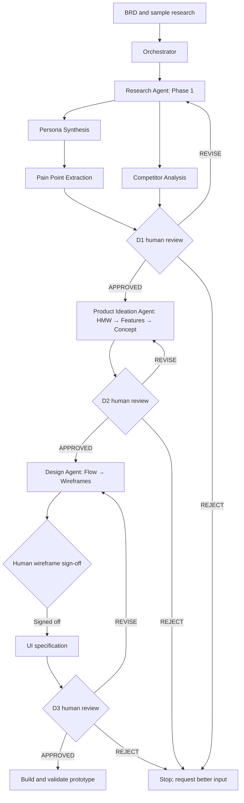
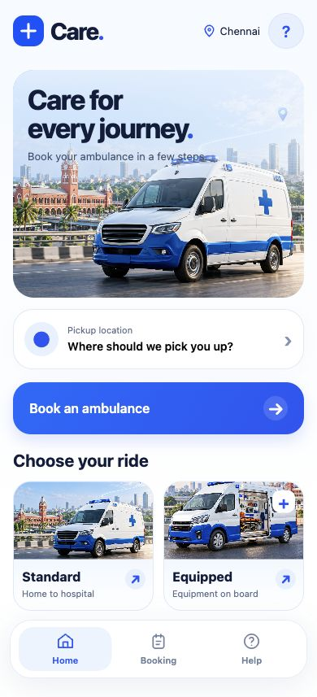

# Care — Ambulance Booking AI Design Workflow

A Week 3 AI-for-Designers academic project for a mobile-first ambulance booking concept in Chennai / Tamil Nadu. The problem hypothesis is that requesters need a clearer way to understand transport availability, type, ETA and estimated pricing.

**Current state: COMPLETE — app v3.** The approved visual design is implemented across all seven screens: rich ambulance imagery, visual ride choices, map-style illustrations and blue card/navigation styling. Academic/prototype warning banners remain removed as requested in [Revision 02](workflow/revision-02.md). [Current verification](output/reviews/prototype-verification-v3.md) covers the revised build. All nine phase artifacts and human-approved D1/D2/D3 v1 packages remain preserved as historical workflow evidence; their UI specifications describe v1.

## Instructor review path
1. Read [BRD](input/brd.md) and [sample research](input/research-notes.md).
2. Inspect [routing](workflow/orchestrator.md), phase ownership, and reusable skill contracts.
3. Read the [Phase 1 artifacts](output/phase-01/) and the completed [Phase 2 artifacts](output/phase-02/).
4. Review the recorded [D1](output/reviews/d1-review.md), [D2](output/reviews/d2-review.md) and [D3](output/reviews/d3-review.md) decisions, including wireframe sign-off.
5. Inspect [execution log](workflow/run-log.md) for actual parallel work, chaining and handoffs; then try [the app](app/index.html) and review [current verification](output/reviews/prototype-verification-v3.md).

## Concepts demonstrated
Orchestrator and state routing; three phase owners; nine reusable skills; parallel persona/comparison work; chained pain-point extraction; review gates; human-in-the-loop decisions; handoffs with manifests; decision rules; exception handling; separated inputs/outputs; actual research artifacts. These Markdown agent/skill contracts document responsibilities; they are not an autonomous software runner. The execution log distinguishes work performed from future work.

## Workflow
Input → Orchestrator → Phase 1 Discover → Gate D1 → Phase 2 Define / Ideate → Gate D2 → Phase 3 Design → Gate D3 → App Prototype



The two Phase 1 branches start independently. Pain points depend on the persona; D1 waits for all three outputs. Every human checkpoint stops progression until an explicit decision. The wireframe sign-off inside Phase 3 fulfills the requirement to use an approved wireframe for UI generation.

## Folder structure
```text
ambulance-booking-ai-workflow/
├── README.md
├── input/
│   ├── brd.md
│   ├── research-notes.md
│   └── design-reference.md
├── workflow/
│   ├── orchestrator.md
│   ├── phase-01-discover.md
│   ├── phase-02-define-ideate.md
│   ├── phase-03-design.md
│   └── run-log.md
├── agents/
│   ├── research-agent.md
│   ├── product-ideation-agent.md
│   └── design-agent.md
├── skills/
│   ├── persona-synthesis.md
│   ├── pain-point-extraction.md
│   ├── competitor-analysis.md
│   ├── how-might-we.md
│   ├── feature-decomposition.md
│   ├── concept-direction.md
│   ├── user-flow-generation.md
│   ├── wireframe-planning.md
│   └── ui-spec-generation.md
├── gates/
│   ├── gate-d1-research-review.md
│   ├── gate-d2-concept-review.md
│   └── gate-d3-design-review.md
├── output/
│   ├── phase-01/{persona,pain-points,competitor-notes}.md
│   ├── phase-02/{hmw,feature-opportunities,concept-direction}.md
│   ├── phase-03/{user-flow,wireframe-plan,ui-spec}.md
│   └── reviews/{d1,d2,d3}-review.md
└── app/{index.html,style.css,script.js}
```

Output manifest: Phase 2 generates `hmw.md`, `feature-opportunities.md`, `concept-direction.md`; Phase 3 generates `user-flow.md`, `wireframe-plan.md`, `ui-spec.md`; app build generates `index.html`, `style.css`, `script.js`. All phase and app files now exist. Additional verification records and screenshots are in output/reviews/ and output/screenshots/.

## Phases and agents
| Phase | Owner | Input | Deliverables | Exit |
|---|---|---|---|---|
| 1 Discover | Research Agent | BRD + sample research | Persona, pain points, illustrative comparison | D1 |
| 2 Define / Ideate | Product Ideation Agent | Reviewed research + APPROVED D1 | HMWs, opportunities, one concept | D2 |
| 3 Design | Design Agent | Approved concept + research + APPROVED D2 | Flow, signed-off wireframe, UI spec | D3 |
| Prototype | Design Agent | Reviewed design + APPROVED D3 | Mobile HTML/CSS/JS and verification | Complete |

## Skill summary
| Skill | Transformation |
|---|---|
| Persona Synthesis | Sample observations → role, needs and gaps |
| Pain Point Extraction | Persona + samples → evidence-linked problems |
| Competitor Analysis | Illustrative C01–C03 archetypes → comparison hypotheses |
| How Might We | Reviewed problems → open opportunities |
| Feature Decomposition | HMWs + persona + problems → testable feature hypotheses |
| Concept Direction | Opportunities + research → focused scope |
| User Flow Generation | Concept + features → journey and failure paths |
| Wireframe Planning | Flow + persona → screen hierarchy and actions |
| UI Spec Generation | Signed-off wireframes + concept → components and states |

## Gate summary and review protocol
| Gate | Human checks | Current status | Next permitted stage |
|---|---|---|---|
| D1 | Sample evidence, assumptions, traceability, gaps | APPROVED (Phase 1 v1) | Phase 2 authorized |
| D2 | Problem/feature links, hypotheses, focus, scope | APPROVED (Phase 2 v1) | Phase 3 authorized |
| D3 | Flow, emergency fallback, estimates, accessibility, no medical decisions | APPROVED (Phase 3 v1) | App built and verified |

Human reviewers choose APPROVE, REVISE or REJECT and supply feedback. Record APPROVE as `Status: APPROVED`, plus reviewer, decision date and exact artifact versions. Preserve decision history. Technical validation does not grant approval. REVISE returns to the owner; REJECT stops for better input. Upstream changes invalidate dependent approvals. A chat approval can be recorded in the review file by the assistant with the human clearly identified.

## Evidence and visual reference
All S01–S08 notes are **sample research input for workflow demonstration**. They are not field interviews. C01–C03 are illustrative interface archetypes, not market findings. Strong/medium/weak describe support inside this simulated set; none establish real-world validity. Actual service data and medical advice are excluded.

[Design reference](input/design-reference.md) is the supplied Coinbase analysis, copied unchanged. It informs future visual styling only: white and soft gray surfaces, restrained blue, regular-weight headlines, pill controls and rounded cards. Proprietary fonts and branding are not required. It is not evidence about ambulance users or services.

## Screenshots
Current app v3 browser captures:

| Screen | Evidence |
|---|---|
| Home | [Home](output/screenshots/v3/01-home.jpg) |
| Pickup details | [Pickup details](output/screenshots/v3/02-pickup.jpg) |
| Ambulance type | [Ambulance type](output/screenshots/v3/03-type-arrival.jpg) |
| Review estimates | [Review estimates](output/screenshots/v3/04-review.jpg) |
| Request receipt | [Request receipt](output/screenshots/v3/05-request.jpg) |
| Request status | [Request status](output/screenshots/v3/06-status.jpg) |
| Help | [Help](output/screenshots/v3/07-support.jpg) |



[Historical v1 verification](output/reviews/prototype-verification.md) and its original screenshots remain available.

## Run locally
Run from this project directory:

```sh
python3 -m http.server 8000 --directory app
```

Open `http://localhost:8000` in a browser. Use a 390px mobile viewport; also check 320px and desktop. No dependency installation is needed. The local preview for this session is [available on port 8000](http://127.0.0.1:8000/).

## GitHub Pages publishing
Publishing is a future step; no repository or deployment has been created by this run. A simple path is to copy the completed static app files to the repository's `/docs` folder, put `index.html` at that folder's top level, and add an empty `.nojekyll`. Push to your chosen branch. In repository Settings → Pages, configure branch publishing from that branch and `/docs`. Keep asset links relative. The original `app/` remains the development artifact. Verify deployed navigation and the booking journey before sharing.

GitHub requires the entry file at the top level of the chosen publishing folder; alternatively an Actions deployment can upload only `app/`. See [GitHub Pages creation instructions](https://docs.github.com/en/pages/getting-started-with-github-pages/creating-a-github-pages-site). The design is approved; no deployment workflow is enabled in this repository.

## Project context
The academic/prototype warning banners were removed from the app in v2 at the user's explicit request. Availability, ETA, fare and status values are local fixtures; the app has no provider, calling or dispatch integration. Technical context remains in documentation. Original phase artifacts and approval records retain their historical v1 requirements.
